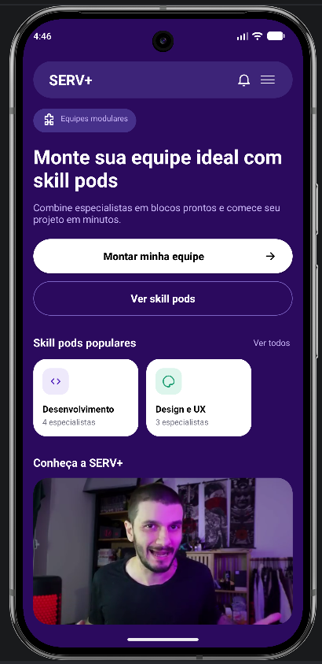
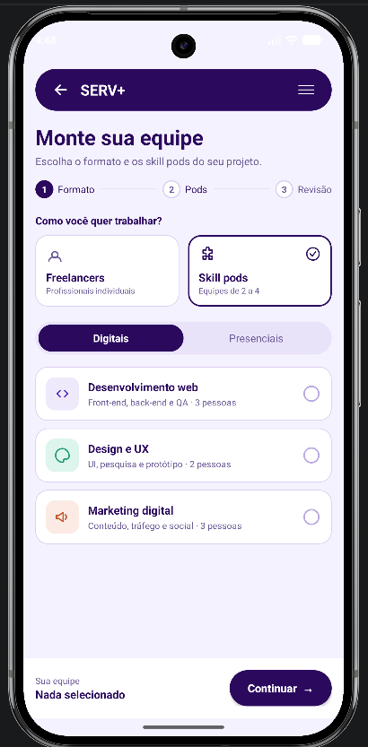
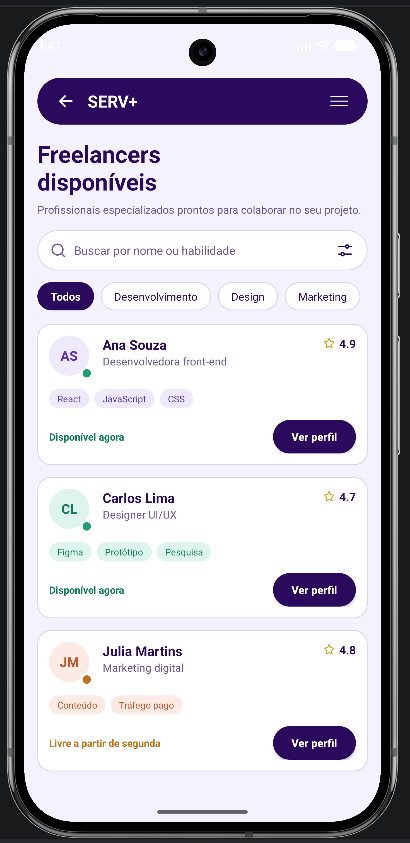
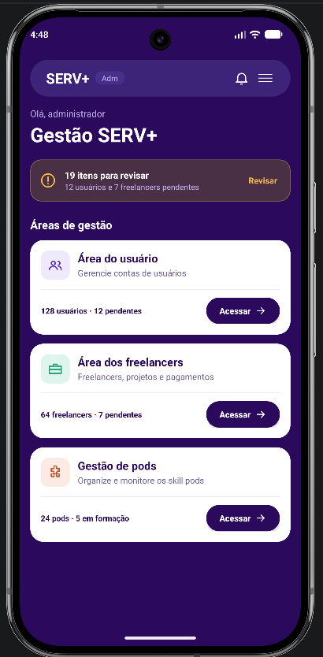

[README.md](https://github.com/user-attachments/files/33504658/README.md)
<div align="center">

# SERV+

**Monte sua equipe ideal com Skill Pods.**

Aplicativo Android que conecta pessoas e empresas a freelancers e a equipes modulares de 2 a 4 profissionais, os *Skill Pods*, prontas para começar um projeto em minutos.


</div>

---

## Sobre o projeto

O **SERV+** nasceu de uma ideia simples: contratar um freelancer avulso nem sempre resolve um projeto inteiro, e montar uma equipe do zero leva tempo. Por isso o app trabalha com dois formatos:

- **Freelancers**: profissionais individuais, com filtro por área, avaliação e disponibilidade.
- **Skill Pods**: equipes modulares de 2 a 4 especialistas que se complementam (por exemplo, desenvolvimento web com front-end, back-end e QA), disponíveis em formato **digital** ou **presencial**.

O app também conta com uma **área administrativa** para acompanhar usuários, freelancers e pods.

## Algumas Telas

<div align="center">

| Home | Montar equipe | Freelancers | Gestão (Admin) |
|:---:|:---:|:---:|:---:|
|  |  |  |  |

</div>

## Funcionalidades

### Home
- Apresentação do conceito de equipes modulares
- Atalhos para **Montar minha equipe** e **Ver skill pods**
- Seção de **Skill pods populares**
- Vídeo institucional **Conheça a SERV+** (reproduzido com `VideoView`)

### Montar equipe
Fluxo em 3 etapas com indicador de progresso:
1. **Formato**: escolha entre Freelancers ou Skill Pods
2. **Pods**: seleção entre pods Digitais ou Presenciais (Desenvolvimento web, Design e UX, Marketing digital)
3. **Revisão**: conferência da equipe antes de continuar

### Freelancers disponíveis
- Busca por nome ou habilidade
- Filtros por área: Todos, Desenvolvimento, Design e Marketing
- Cards com avaliação, habilidades e status de disponibilidade
- Acesso ao perfil do profissional

### Gestão SERV+ (Admin)
- Alerta com itens pendentes de revisão
- Três áreas de gestão: **Usuários**, **Freelancers** (projetos e pagamentos) e **Pods**
- Indicadores resumidos em cada área

## Tecnologias

| Categoria | Ferramentas |
|---|---|
| Plataforma | Android nativo |
| Linguagem | Java |
| IDE | Android Studio |
| Build | Gradle |
| Mídia | VideoView |
| Testes | Emulador Pixel 9 Pro (API 37) |

## Como executar

**Pré-requisitos:** [Android Studio](https://developer.android.com/studio) instalado e um emulador ou dispositivo Android configurado.

```bash
# 1. Clone o repositório
git clone https://github.com/oricoMiguel/Mobile.git

# 2. Abra a pasta no Android Studio
# 3. Aguarde a sincronização do Gradle
# 4. Selecione um emulador/dispositivo e clique em Run ▶
```

## Estrutura do projeto

```
Mobile/
├── app/
│   └── src/main/
│       ├── java/        # Activities e lógica do app
│       └── res/         # Layouts, drawables, strings e vídeo (raw)
├── docs/
│   └── screenshots/     # Imagens usadas neste README
├── build.gradle
└── settings.gradle
```

## Roadmap

- [x] Tela Home com vídeo institucional
- [x] Fluxo Montar equipe (etapas 1 e 2)
- [x] Listagem de Freelancers disponíveis
- [x] Painel de gestão (Admin)
- [ ] Etapa 3 do fluxo: Revisão da equipe
- [ ] Tela de Skill Pods disponíveis
- [ ] Listas administrativas de usuários, freelancers e pods

## Autor

**Miguel**
Estudante de Análise e Desenvolvimento de Sistemas, Escola Senai Armando de Arruda Pereira (Mauá/SP)

[](https://github.com/oricoMiguel)
